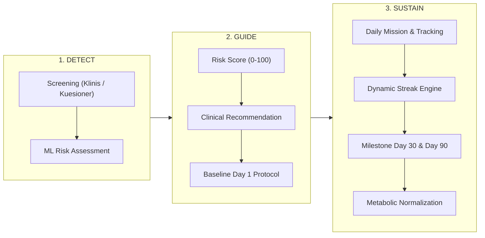
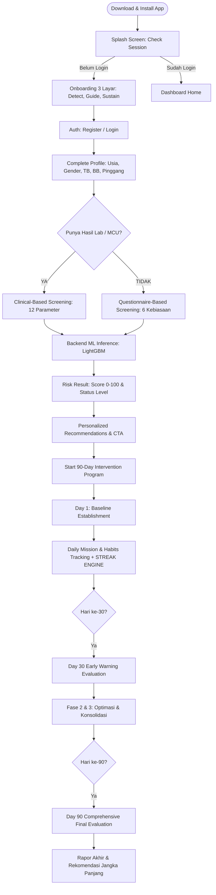
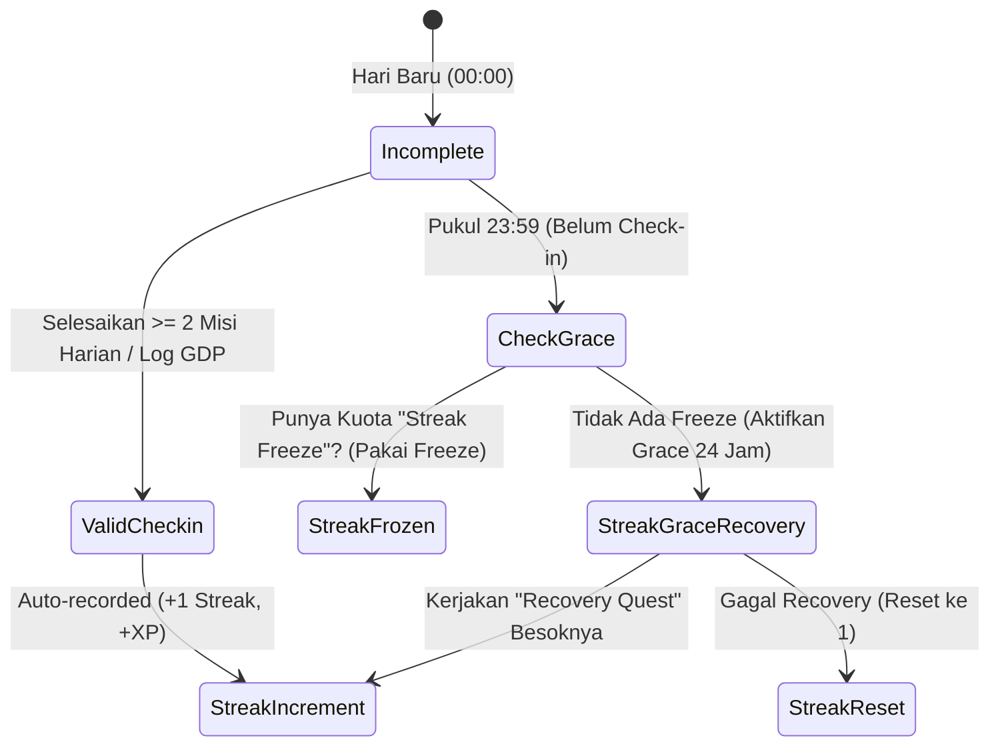
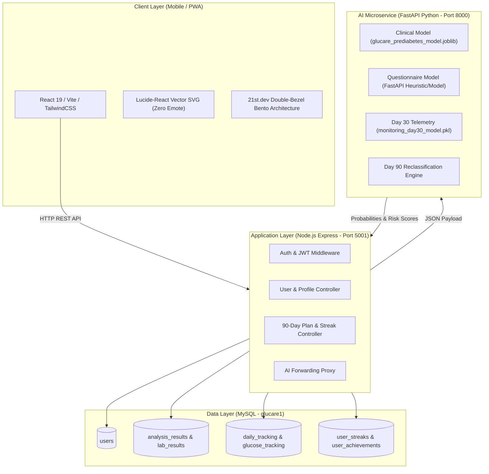

# PRODUCT REQUIREMENTS DOCUMENT (PRD)
## GluCare Mobile Application — AI-Powered Prediabetes Intervention

---

## 1. Document Control & Metadata

| Field | Detail |
| :--- | :--- |
| **Product Name** | GluCare Mobile Application |
| **Version** | 1.1.0 (Production Blueprint) |
| **Document Status** | Approved / Ready for Implementation |
| **Platform** | Mobile Application (iOS & Android) / Progressive Web App |
| **Core Focus** | Deteksi dini risiko prediabetes berbasis Machine Learning (NHANES) & program intervensi gaya hidup terstruktur 90 hari |
| **Target User** | Dewasa muda & individu berisiko (usia 20–45+ tahun) yang ingin mengetahui profil glikemik serta membangun kebiasaan hidup sehat berkelanjutan |
| **AI Models** | 1. Clinical-Based Screening (LightGBM 12-Biomarker)<br>2. Questionnaire-Based Screening (6-Feature Non-Invasif)<br>3. Day-30 Telemetry Monitoring Model<br>4. Day-90 Outcome Reclassification Model |
| **Program Duration** | 90 Hari (3 Fase Intervensi: Stabilisasi, Optimasi, Konsolidasi) |

---

## 2. Product Overview & Vision

**GluCare** adalah aplikasi kesehatan preventif cerdas yang dirancang untuk menjembatani jurang (*gap*) antara ketidaktahuan risiko metabolik dini dengan intervensi kebiasaan harian yang berkelanjutan. Prediabetes bersifat *reversible* (dapat disembuhkan dan dikembalikan normal) jika diintervensi pada "Fase Emas" (*Golden Window*).

### Konsep Inti: DETECT → GUIDE → SUSTAIN


1. **DETECT**: Mengidentifikasi estimasi risiko gangguan glukosa dan resistensi insulin tanpa vonis menakutkan, menyediakan jalur dengan data laboratorium maupun non-invasif.
2. **GUIDE**: Memberikan preskripsi gaya hidup harian (Tidur, Aktivitas Fisik, Nutrisi) yang disesuaikan secara personal dari profil metabolik.
3. **SUSTAIN**: Menjaga momentum perubahan perilaku melalui monitoring telemetri harian, **Streak Engine cerdas anti-demotivasi**, gamifikasi XP level, serta evaluasi berkala Day 30 dan Day 90.

> [!NOTE]
> **Disclaimer Medis**: GluCare adalah sistem pendukung keputusan skrining risiko dan intervensi gaya hidup preventif, **bukan** alat penegak diagnosis medis definitif. Pasien dengan risiko tinggi selalu diarahkan berkonsultasi dengan dokter spesialis.

---

## 3. Target Persona & User Segment

| Persona | Profil & Karakteristik | Kebutuhan Utama di GluCare |
| :--- | :--- | :--- |
| **Persona A: "The Busy Professional"**<br>(Usia 26–35 tahun) | • Jam kerja padat, kurang tidur (<6 jam), sedentary life.<br>• Memiliki riwayat keluarga DM atau lingkar perut berlebih.<br>• Belum sempat/takut cek darah di lab. | • Membutuhkan skrining cepat tanpa jarum (*Questionnaire Screening*).<br>• Butuh checklist harian sederhana & pengingat konsistensi (*Streak*). |
| **Persona B: "The Health-Conscious Checker"**<br>(Usia 30–45 tahun) | • Baru saja melakukan Medical Check-Up (MCU) tahunan.<br>• Gula darah puasa berkisar 100–125 mg/dL (ambang prediabetes).<br>• Bingung menerjemahkan hasil lab ke tindakan konkret. | • Memasukkan angka MCU ke *Clinical-Based Screening*.<br>• Program intervensi 90 hari berbasis target klinis (penurunan HbA1c/GDP). |
| **Persona C: "The Lifestyle Rebounder"** | • Pernah mencoba diet/olahraga tapi sering putus di tengah jalan.<br>• Mudah hilang motivasi jika absen 1 hari (*what-the-hell effect*). | • Mekanisme *Streak Protection / Freeze* dan gamifikasi XP.<br>• Evaluasi bertahap Day 30 & Day 90 yang terukur. |

---

## 4. End-to-End User Journey



---

## 5. Information Architecture (IA)

```
GLUCARE MOBILE
│
├── 1. Authentication & Onboarding
│   ├── Splash Screen (Session Checker)
│   ├── Onboarding Walkthrough (Detect, Guide, Sustain)
│   ├── Register (Name, Email, Password, Confirmation)
│   ├── Login & Google OAuth
│   └── Forgot Password / Reset
│
├── 2. Profile Setup
│   └── Complete Profile (Birth Date, Gender, Height, Weight, Waist)
│
├── 3. Risk Assessment Hub
│   ├── Screening Gateway ("Do you have recent lab results?")
│   ├── Clinical Screening Form (FPG, Lipid Profile, Blood Pressure, MAP)
│   ├── Questionnaire Screening Form (Age Band, BMI Cat, Habits, Family Hist)
│   ├── Validation & Processing Loading
│   └── Risk Result Screen (Score 0-100, Clinical Explanation, Recommendation)
│
├── 4. Main App (Bottom Navigation - 4 Tabs)
│   │
│   ├── TAB 1: Home (Dashboard)
│   │   ├── User Greeting & Date
│   │   ├── Risk Summary Hero Banner
│   │   ├── 90-Day Program Day Progress Counter
│   │   ├── Bento Gamification Row:
│   │   │   ├── Active Adherence Streak Counter (Flame Icon)
│   │   │   ├── Metabolic Level & XP Tier (Zap Icon)
│   │   │   └── Achievement Badge Count (Award Icon)
│   │   ├── Today's Bio-Habit Mission Checklist
│   │   └── Quick Glucose (GDP) Log Shortcut
│   │
│   ├── TAB 2: Program (90-Day Intervention)
│   │   ├── 90-Day Intervention Overview & Roadmap 3 Fase
│   │   ├── Current Phase Details (Stabilisasi / Optimasi / Konsolidasi)
│   │   ├── Daily Protocol Mission Submission
│   │   ├── Fasting Blood Glucose (GDP) Log & ADA Benchmark
│   │   ├── Day 30 Telemetry Milestone Banner
│   │   └── Day 90 Final Evaluation Banner
│   │
│   ├── TAB 3: Progress & Telemetry Analytics
│   │   ├── Risk Evolution (Baseline vs Current)
│   │   ├── 7-Day & 30-Day Activity Trend Bar Chart
│   │   ├── Sleep Consistency & Duration Metric
│   │   ├── Nutrition Adherence Score
│   │   ├── Glucose Slope & Variance Tracker
│   │   ├── Habit Correlation Insights (Sleep/Steps vs Glucose)
│   │   └── Streak History & Achievements Locker
│   │
│   └── TAB 4: Profile & Account Settings
│       ├── Personal Demographics (Age, Gender, Body Metrics)
│       ├── Clinical History & Lab Storage
│       ├── Security (Change Password)
│       ├── Notifications & Reminder Preferences
│       ├── Privacy Policy & Medical Disclaimers
│       └── Logout
```

---

## 6. Functional Requirements

### 6.1 Splash Screen
* **Tujuan**: Menampilkan identitas visual brand dan memvalidasi token sesi pengguna.
* **Fitur**:
  * Menampilkan logo resmi GluCare dengan animasi *fade-in*.
  * Pemeriksaan token JWT di penyimpanan lokal (*secure storage*).
  * *Routing Logic*:
    * Token Valid & Terdaftar $\rightarrow$ Arahkan ke **Home Dashboard**.
    * Token Tidak Ada / Kedaluwarsa $\rightarrow$ Arahkan ke **Onboarding Screen**.

### 6.2 Onboarding Walkthrough
* **Tujuan**: Mengedukasi pengguna baru mengenai proposisi nilai GluCare.
* **Layar**:
  * *Layar 1: Understand Your Risk* — Prediksi risiko prediabetes dengan AI tanpa stigma.
  * *Layar 2: Build Better Habits* — Misi harian terarah (tidur, jalan kaki, pola piring sehat).
  * *Layar 3: Sustain & Reverse* — Pertahankan *streak* harian dan balikkan kondisi prediabetes ke zona aman dalam 90 hari.
* **CTA**: Tombol `Mulai Sekarang` mengarahkan ke halaman Register/Login.

### 6.3 Authentication
* **Register**: Nama lengkap, email valid, kata sandi (minimal 8 karakter, kombinasi huruf & angka).
* **Login**: Email & kata sandi dengan opsi *Remember Me*. Dukungan Google Sign-In terintegrasi.
* **Lupa Kata Sandi**: Pengiriman tautan reset ke email terdaftar.

### 6.4 Complete Profile
* **Field Wajib**:
  * Tanggal Lahir (untuk perhitungan usia presisi).
  * Jenis Kelamin Biologis (Laki-laki / Perempuan) — parameter penting perhitungan risiko metabolik.
  * Tinggi Badan (cm) & Berat Badan (kg) — otomatis menghitung BMI.
  * Lingkar Pinggang (cm) — parameter adipositas visceral sentral.

---

## 7. Dual-Path AI Screening Engine

Pengguna diarahkan melalui *Gateway Screen*: **"Apakah Anda memiliki hasil pemeriksaan laboratorium darah terbaru?"**

```
                     [Gateway Assessment]
                              │
             ┌────────────────┴────────────────┐
             ▼                                 ▼
           [YES]                              [NO]
  Clinical-Based Screening         Questionnaire-Based Screening
  (Untuk pemilik data MCU/Lab)     (Non-Invasif Gaya Hidup)
```

### 7.1 Path A: Clinical-Based Screening (12 Parameter)
* **Model Machine Learning**: Calibrated LightGBM Classifier (Akurasi Uji: 91.2%, Sensitivitas: 89.4%).
* **Fitur Input**:
  1. `glucose_fasting`: Gula Darah Puasa (GDP) dalam mg/dL.
  2. `age`: Usia pasien (tahun).
  3. `gender`: Jenis kelamin (1: Laki-laki, 0: Perempuan).
  4. `weight`: Berat badan (kg).
  5. `height`: Tinggi badan (cm).
  6. `bmi`: Indeks Massa Tubuh ($BB / (TB/100)^2$).
  7. `waist_cm`: Lingkar pinggang (cm).
  8. `bp_systolic`: Tekanan darah sistolik (mmHg).
  9. `bp_diastolic`: Tekanan darah diastolik (mmHg).
  10. `hdl`: Kolesterol HDL (mg/dL).
  11. `triglycerides`: Trigliserida (mg/dL).
  12. `map_pressure`: Mean Arterial Pressure ($[Sistolik + 2 \times Diastolik] / 3$).
  13. `tg_hdl_ratio`: Rasio Trigliserida terhadap HDL.

### 7.2 Path B: Questionnaire-Based Screening (6 Fitur Non-Invasif)
* **Aturan Kunci**: **Dilarang keras meminta data laboratorium** (tanpa GDP, HDL, Trigliserida, HbA1c).
* **Fitur Input**:
  1. `age_band`: Kategori Usia (0: <30 tahun, 1: 30–39 tahun, 2: $\ge 40$ tahun).
  2. `gender`: Jenis kelamin (1: Laki-laki, 0: Perempuan).
  3. `bmi_category`: Kategori BMI (0: Normal $<23$, 1: Overweight $23–27.4$, 2: Obesitas $\ge 27.5$).
  4. `waist_category`: Kategori Lingkar Perut (0: Rendah, 1: Berisiko $>90$ cm Pria / $>80$ cm Wanita).
  5. `hypertension`: Riwayat/gejala hipertensi (0: Tidak, 1: Ya).
  6. `overweight_history`: Riwayat kelebihan berat badan dalam keluarga/pribadi (0: Tidak, 1: Ya).

### 7.3 Output Standar Hasil Skrining
* **Risk Score**: Skala kontinu 0–100%.
* **Risk Level**:
  * **Normal / Rendah** ($<30\%$): Metabolisme optimal.
  * **Prediabetes / Sedang** ($30\% - 59\%$): Fase emas intervensi gaya hidup reversibel.
  * **Tinggi / Indikasi Diabetes** ($\ge 60\%$): Disarankan evaluasi medis lab lanjutan.
* **CTA**: Tombol `Mulai Program 90 Hari`.

---

## 8. SPESIFIKASI KHUSUS: STREAK ENGINE & HABIT ADHERENCE

> [!IMPORTANT]
> **Rasional Klinis**: Pembentukan kebiasaan baru (*neuroplasticity*) membutuhkan pengulangan minimal 21–66 hari berturut-turut. Konsistensi harian mencegah lonjakan glukosa fluktuatif (*glucose variability*). Namun, sistem streak konvensional yang langsung mereset ke angka 0 saat pengguna terlewat 1 hari sering memicu *The "What-The-Hell" Effect* (pengguna merasa gagal dan meninggalkan aplikasi). GluCare menerapkan **Cerdas Streak Engine Berbasis Kepatuhan Klinis & Grace Recovery**.

### 8.1 Definisi & Logika Kepatuhan Harian
Sebuah hari dihitung sebagai **"Check-in Valid" (+1 Streak)** apabila memenuhi salah satu dari kriteria berikut sebelum pukul 23:59 waktu lokal:
1. Menyelesaikan minimal **2 dari 3 misi harian** (misal: Tidur Terjadwal + Aktivitas Fisik).
2. ATAU melakukan pencatatan Log Gula Darah Puasa (GDP) hari tersebut.



### 8.2 Parameter Database Streak (`user_streaks`)
| Kolom | Tipe | Deskripsi |
| :--- | :--- | :--- |
| `user_id` | INT | Foreign key ke tabel `users`. |
| `current_streak` | INT | Jumlah hari berturut-turut yang sedang aktif saat ini. |
| `longest_streak` | INT | Rekor streak terpanjang yang pernah dicapai. |
| `last_checkin_date` | DATE | Tanggal terakhir check-in valid (YYYY-MM-DD waktu WIB/lokal). |
| `freeze_credits` | INT | Kuota perlindungan streak (Maksimal 2 kuota aktif). |
| `grace_status` | ENUM | `'NONE'`, `'FROZEN'`, `'PENDING_RECOVERY'`. |
| `streak_updated_at`| TIMESTAMP | Waktu audit log terakhir. |

### 8.3 Mekanisme Anti-Demotivasi: "Streak Freeze" & "Recovery Quest"
1. **Streak Freeze Otomatis (Perlindungan Sakit / Absen Darurat)**:
   * Setiap pengguna mendapatkan **1 kuota Streak Freeze gratis setiap 14 hari kepatuhan berturut-turut**.
   * Jika pengguna tidak mencatat kebiasaan pada hari tertentu, sistem otomatis memakai 1 kuota freeze: streak **tidak hangus** dan tetap berada di angka sebelumnya.
2. **Grace Period Recovery (24 Jam Pemulihan)**:
   * Jika pengguna kehabisan kuota freeze dan melewatkan 1 hari, streak memasuki status `PENDING_RECOVERY`.
   * Pada hari berikutnya, sistem memberikan **"Recovery Mission"** (misal: Jalan 45 menit + catat tidur tepat waktu). Jika diselesaikan, streak kembali utuh tanpa reset ke 0.
   * Jika recovery gagal, barulah streak direset ke hari ke-1 (XP dan pencapaian sebelumnya tetap tersimpan permanen).

### 8.4 Tingkatan Milestone & Lencana Streak
Sistem mengapresiasi konsistensi pengguna dengan tingkatan lencana (*Milestone Badges*):

| Tingkat Milestone | Target Streak | Bukti Biologis / Manfaat Klinis | Reward XP | Nama Lencana |
| :--- | :---: | :--- | :---: | :--- |
| **Tier 1: Kickoff** | **3 Hari** | Inisiasi ritme sirkadian metabolisme. | `+25 XP` | *First Step Spark* |
| **Tier 2: Weekly** | **7 Hari** | Penurunan resistensi insulin akut sel hepar. | `+100 XP` | *Week Warrior* |
| **Tier 3: Fortnight** | **14 Hari** | Peningkatan translokasi transporter GLUT4 otot. | `+200 XP` | *Consistency Champion* |
| **Tier 4: Habit Form** | **21 Hari** | Pembentukan sirkuit kebiasaan bawah sadar (*habit loop*).| `+300 XP` | *Metabolic Habit Lock* |
| **Tier 5: Phase 1** | **30 Hari** | Stabilisasi dasar glukosa; siap evaluasi milestone Day 30.| `+500 XP` | *Stabilization Master* |
| **Tier 6: Phase 2** | **60 Hari** | Peningkatan massa otot metabolik & sensitivitas sel beta.| `+750 XP` | *Metabolic Optimizer* |
| **Tier 7: Full Program**| **90 Hari** | Normalisasi homeostasis jangka panjang & remisi prediabetes.| `+1000 XP` | *Homeostasis Hero* |

### 8.5 Korelasi Streak dengan Model AI Day-30 & Day-90
Streak bukan sekadar ornamen gamifikasi. Variabel `max_streak_m1` (rekor streak di bulan pertama) dan `adherence_consistency` dikirim langsung ke **Model AI Evaluasi Telemetri** sebagai fitur prediktor:
$$\text{Probability of Improvement} = f(\text{Glucose Slope}, \text{Adherence Rate}, \mathbf{MaxStreak})$$
Data membuktikan bahwa pengguna dengan *streak $\ge 21$ hari* memiliki probabilitas perbaikan glukosa puasa 3.8 kali lebih tinggi dibandingkan pengguna dengan streak terputus-putus.

---

## 9. Struktur Program Intervensi 90 Hari

Program intervensi dibagi menjadi 3 fase klinis:

```
┌─────────────────────────────────────────────────────────────────────────┐
│                          ROADMAP 90 HARI GLUCARE                        │
├────────────────────┬────────────────────┬───────────────────────────────┤
│ FASE 1 (Hari 1–30) │ FASE 2 (Hari 31–60)│ FASE 3 (Hari 61–90)           │
│ Stabilisasi Dasar  │ Optimasi Metabolik │ Konsolidasi & Retensi         │
│ • Eliminasi Gula   │ • Translokasi GLUT4│ • Homeostasis Persisten       │
│ • Ritme Tidur 7.5j │ • Latihan Beban    │ • Kemandirian Gaya Hidup      │
│ • Jalan 30 mnt/hr  │ • Jalan 40 mnt/hr  │ • Jalan 45 mnt/hr             │
├────────────────────┼────────────────────┼───────────────────────────────┤
│ Day 1: Baseline    │ Day 30: AI Review  │ Day 90: Final Comprehensive   │
└────────────────────┴────────────────────┴───────────────────────────────┘
```

### 9.1 Day 1 — Baseline Establishment
* Menyimpan parameter awal: Skor Risiko Awal, Baseline Glukosa Puasa, Berat Badan Awal, Lingkar Perut Awal.
* Menetapkan target harian preskriptif:
  * Target Tidur: 7.0–8.0 Jam semalam.
  * Target Aktivitas: 30–45 Menit per hari.
  * Target Nutrisi: Pola Piring Sehat (50% Sayur & Serat, 25% Protein, 25% Karbohidrat Kompleks).

### 9.2 Daily Mission & Telemetry Tracking
Setiap hari pengguna memvalidasi 3 pilar:
1. **Pilar Tidur**: Memvalidasi jam tidur semalam (menjaga ritme melatonin & menekan hormon stres kortisol malam hari).
2. **Pilar Aktivitas Fisik**: Memvalidasi durasi aktivitas (jalan cepat/jogging) untuk merangsang penyerapan glukosa non-insulin dependen via GLUT4 otot.
3. **Pilar Nutrisi**: Memvalidasi kepatuhan pembatasan minuman manis dan konsumsi serat tinggi.
4. **Log GDP (Opsional Tiap 7–14 Hari)**: Memasukkan angka GDP meter mandiri untuk memantau penurunan glukosa puasa.

### 9.3 Day 30 — Telemetry Milestone Review
* **Model AI**: `monitoring_day30_model.pkl`.
* **Input Evaluasi**:
  * Rata-rata glukosa bulan ke-1 (`glucose_month1_mean`).
  * Kemiringan tren glukosa (`glucose_slope_month1`).
  * Konsistensi aktivitas & tidur (`steps_consistency_m1`, `sleep_consistency_m1`).
  * Rekor streak bulan ke-1 (`max_streak_m1`).
* **Output Klinis**:
  * *Early Warning Status*: `Membaik` vs `Perlu Perhatian Khusus`.
  * Feedback personal: Rekomendasi penyesuaian porsi latihan atau jam istirahat untuk memasuki Fase 2.

### 9.4 Day 90 — Final Outcome Evaluation & Report
* **Model AI**: Calibrated Reclassification Model.
* **Perbandingan Lengkap**:
  * Skor Risiko Awal (Day 1) vs Skor Risiko Akhir (Day 90).
  * Delta perubahan glukosa puasa ($\Delta \text{GDP}$).
  * Total akumulasi XP dan pencapaian lencana streak.
* **Rapor Klinis Akhir (PDF Downloadable)**:
  * Rangkuman grafik perkembangan telemetri 90 hari.
  * Catatan kelayakan remisi prediabetes untuk dibawa saat konsultasi dokter.

---

## 10. Spesifikasi Teknis & Arsitektur Sistem



### 10.1 Status State Machine Pengguna
Backend melacak siklus hidup akun pengguna melalui state yang ketat:
```
REGISTERED
    ↓
PROFILE_COMPLETED
    ↓
ASSESSMENT_PENDING
    ↓
ASSESSMENT_COMPLETED
    ↓
PROGRAM_ENROLLED (Day 1 Baseline Saved)
    ↓
PHASE_1_ACTIVE (Day 1–30 Tracking)
    ↓
DAY_30_MILESTONE_READY
    ↓
PHASE_2_ACTIVE (Day 31–60 Tracking)
    ↓
PHASE_3_ACTIVE (Day 61–90 Tracking)
    ↓
DAY_90_EVALUATION_READY
    ↓
PROGRAM_GRADUATED (Final Report Generated)
```

---

## 11. Roadmap Implementasi MVP

| Fase | Target Modul & Fitur | Kriteria Kelulusan (Acceptance Criteria) |
| :--- | :--- | :--- |
| **Fase 1: Authentication & Profiling** | Splash, Onboarding 3 layar, Register, Login JWT, Complete Profile. | Pengguna dapat mendaftar, mengisi data demografis, dan data tersimpan di MySQL. |
| **Fase 2: Dual AI Screening Hub** | Gateway pemilihan skrining, form Clinical 12-fitur, form Questionnaire 6-fitur, integrasi API FastAPI port 8000. | Prediksi AI menghasilkan Risk Score (0–100) dan Risk Level dengan response time $<800$ ms. |
| **Fase 3: Recommendation & Baseline** | Halaman Hasil Skrining, preskripsi gaya hidup terpersonalisasi, enrollment Day 1 baseline. | Data baseline tersimpan di database dan status pengguna berubah menjadi `PROGRAM_ENROLLED`. |
| **Fase 4: 90-Day Engine & Streak** | Bento Home Dashboard, 3 checklist misi harian, Streak Engine (+1, freeze, grace recovery), Log GDP. | Pengguna dapat check-in harian, streak terhitung akurat sesuai tanggal kalender, XP bertambah. |
| **Fase 5: Telemetry Evaluation & Reporting** | Evaluasi Day 30 via AI microservice, evaluasi Day 90, halaman Pencapaian Lencana, unduh rapor klinis. | AI Day 30 mengeluarkan status *Membaik / Perlu Perhatian*, rapor 90 hari terkomparasi dari baseline. |

---

## 12. Metrik Keberhasilan (Success Metrics / KPIs)

1. **Akurasi & Integritas Klinis**:
   * Tingkat korelasi hasil skrining klinis dengan standar ADA $> 90\%$.
   * Zero-error pada forwarding request dari Node.js ke FastAPI microservice ($100\%$ uji coba lulus).
2. **Keterlibatan Pengguna & Kepatuhan Kebiasaan (Engagement & Adherence)**:
   * **7-Day Retention Rate**: $\ge 65\%$ pengguna aktif mempertahankan streak pada minggu pertama.
   * **Average Streak Length**: Rata-rata pengguna mempertahankan streak $\ge 14$ hari berturut-turut.
   * **Program Completion Rate**: $\ge 40\%$ pengguna yang memulai berhasil mencapai evaluasi Day 90.
3. **Dampak Klinis Nyata (Clinical Outcome)**:
   * $\ge 70\%$ pengguna aktif program mengalami tren penurunan glukosa puasa (GDP slope negatif) pada evaluasi Day 30 dan Day 90.
