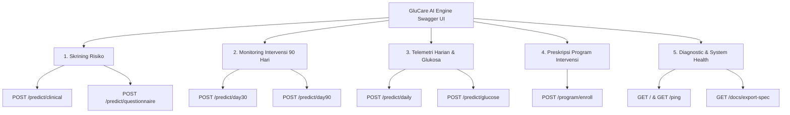

# 📘 Panduan Dokumentasi Swagger UI & OpenAPI Specification — GluCare AI

Dokumentasi ini menjelaskan spesifikasi lengkap **Swagger UI (OpenAPI 3.0)** untuk **GluCare AI Engine**. Swagger UI memungkinkan tim pengembang (*frontend*, *backend*, QA, dan *clinical reviewer*) untuk mengeksplorasi, memahami skema data, serta menguji seluruh endpoint Machine Learning secara interaktif langsung dari peramban web (*browser*).

---

## 🌐 Akses Dokumentasi Swagger

| Layanan | Antarmuka / Format | URL / Lokasi Berkas | Keterangan |
| :--- | :--- | :--- | :--- |
| **GluCare AI Microservice** | **Swagger UI Interaktif** | `http://localhost:8000/docs` | Dokumentasi visual interaktif dengan fitur *Try it out* |
| **GluCare AI Microservice** | **ReDoc Reader** | `http://localhost:8000/redoc` | Tampilan pembaca dokumentasi teknis bergaya buku |
| **GluCare AI Microservice** | **Skema OpenAPI JSON** | `http://localhost:8000/openapi.json` | Skema mentah OpenAPI 3.0.3 (Auto-generated) |
| **GluCare AI Microservice** | **Ekspor Skema Mandiri** | `http://localhost:8000/docs/export-spec` | Endpoint unduh OpenAPI JSON untuk impor ke Postman / SwaggerHub |
| **GluCare AI Microservice** | **Berkas Statis Repositori** | `docs/swagger_ai_spec.json` | Salinan lokal berformat JSON siap pakai tanpa perlu server menyala |
| **GluCare Backend Express** | **Swagger UI Gateway** | `http://localhost:5001/api-docs` | Dokumentasi API Gateway Node.js yang meneruskan ke AI |

---

## 📑 Struktur Kelompok Tag Endpoint (API Taxonomy)

Endpoints di dalam Swagger UI dikelompokkan ke dalam 5 kategori logis:



---

## 🔌 Rincian Lengkap Endpoint API

### 1. Skrining Risiko (Clinical & Questionnaire)

#### A. `POST /predict/clinical`
* **Deskripsi**: Skrining risiko prediabetes menggunakan data indikator laboratorium klinis lengkap.
* **Model ML**: *Calibrated Random Forest Pipeline* (dilatih pada CDC NHANES 2021–2023).
* **Performa**: Akurasi 94.66%, Presisi 97.73%, ROC-AUC 0.9634.
* **Contoh Request Payload**:
  ```json
  {
    "user_id": "usr_test_001",
    "glucose_fasting": 105.0,
    "age": 32,
    "gender": 1,
    "weight": 74.5,
    "height": 170.0,
    "bmi": 25.8,
    "waist_cm": 88.0,
    "bp_systolic": 122.0,
    "bp_diastolic": 78.0,
    "hdl": 48.0,
    "triglycerides": 145.0,
    "riwayat_keluarga": 0,
    "riwayat_diabetes": 0
  }
  ```
* **Contoh Respon (200 OK)**:
  ```json
  {
    "prediction": [1],
    "predict_proba": [[0.1500, 0.8500, 0.0]],
    "risk_level": "Prediabetes",
    "score": 85,
    "probability_prediabetes": 0.8500,
    "probability_normal": 0.1500,
    "summary": "Hasil analisis klinis mengindikasikan tingkat risiko: Prediabetes (Skor: 85%)"
  }
  ```

---

#### B. `POST /predict/questionnaire`
* **Deskripsi**: Skrining risiko prediabetes non-invasif berbasis kuesioner gaya hidup (12 faktor risiko NHANES).
* **Model ML**: *GluCare Questionnaire Logistic Regression / Heuristic Fallback*.
* **Performa**: ROC-AUC 0.866, Precision 80.0%.
* **Contoh Request Payload**:
  ```json
  {
    "user_id": "usr_test_001",
    "age_band": 1,
    "gender": 2,
    "bmi_category": 1,
    "waist_category": 1,
    "hypertension": 0,
    "diabetes_history": 0,
    "prediabetes_told": 0,
    "prediabetes_history": 0,
    "physically_active": 0,
    "sedentary_hours": 6.0,
    "current_smoker": 0,
    "poor_diet": 1
  }
  ```
* **Contoh Respon (200 OK)**:
  ```json
  {
    "prediction": [1],
    "predict_proba": [[0.1800, 0.8200, 0.0]],
    "risk_level": "Prediabetes",
    "score": 82,
    "probability_prediabetes": 0.8200,
    "probability_normal": 0.1800,
    "model_source": "ML (NHANES 2021-2023)",
    "summary": "Analisis kuesioner gaya hidup menunjukkan tingkat risiko: Prediabetes (Skor: 82%)"
  }
  ```

---

### 2. Monitoring Intervensi 90 Hari (Milestone)

#### A. `POST /predict/day30`
* **Deskripsi**: Evaluasi trajektori metabolisme pasien pada evaluasi bulan pertama (Hari ke-30).
* **Model ML**: *XGBoost Trajectory Classifier*.
* **Contoh Request Payload**:
  ```json
  {
    "patient_id": "usr_test_001",
    "glucose_month1_mean": 98.5,
    "steps_month1_mean": 7500.0,
    "adherence_pct": 90.0
  }
  ```
* **Contoh Respon (200 OK)**:
  ```json
  {
    "score": 96,
    "risk_level": "Low",
    "trajectory_status": "Membaik",
    "summary": "Tren metabolisme dan kepatuhan gaya hidup Anda di Bulan ke-1 menunjukkan proyeksi positif untuk hari ke-90.",
    "recommendations": "Pertahankan konsistensi jam tidur dan aktivitas fisik harian Anda saat ini.",
    "improving_score_percent": 96.3
  }
  ```

---

#### B. `POST /predict/day90`
* **Deskripsi**: Evaluasi perbandingan profil glukosa bulan ke-1 terhadap bulan ke-3 program intervensi.
* **Contoh Request Payload**:
  ```json
  {
    "patient_id": "usr_test_001",
    "month1_glucose_values": [108.0, 105.0, 102.0],
    "month3_glucose_values": [96.0, 94.0, 92.0]
  }
  ```
* **Contoh Respon (200 OK)**:
  ```json
  {
    "score": 92,
    "risk_level": "Low",
    "summary": "Selamat! Program 90 Hari GluCare berhasil diselesaikan dengan hasil positif.",
    "recommendations": "Pertahankan kebiasaan makan sehat dan olahraga rutin secara konsisten."
  }
  ```

---

### 3. Telemetri Harian & Glukosa (Daily Tracking)

#### A. `POST /predict/daily`
* **Deskripsi**: Evaluasi harian kepatuhan 3 pilar (Tidur, Aktivitas Fisik, Nutrisi) serta umpan balik biologis AI.
* **Contoh Request Payload**:
  ```json
  {
    "user_id": "usr_test_001",
    "day": 1,
    "sleep_hours": 7.5,
    "walking_minutes": 45.0,
    "nutrition_score": 85.0,
    "glucose_value": 98.0,
    "sleep_target_hours": 7.5,
    "walking_target_minutes": 30
  }
  ```
* **Contoh Respon (200 OK)**:
  ```json
  {
    "status": "saved",
    "user_id": "usr_test_001",
    "day": 1,
    "goal_achieved": true,
    "sleep_met": true,
    "walking_met": true,
    "nutrition_met": true,
    "metabolic_impact_score": 95.5,
    "ai_feedback": "Luar biasa! Seluruh target 3 pilar hari ini tercapai (Skor Metabolik: 95.5%). Kombinasi jalan kaki 45 menit dan tidur 7.5 jam ini secara langsung mengaktifkan translokasi GLUT4 di otot, membantu menstabilkan glukosa puasa esok pagi.",
    "tomorrow_tip": "Pertahankan ritme ini. Lakukan peregangan ringan 5 menit sebelum tidur untuk mengoptimalkan deep sleep."
  }
  ```

---

#### B. `POST /predict/glucose`
* **Deskripsi**: Triase klinis instan pengukuran gula darah harian mandiri berdasarkan batas ADA.
* **Contoh Request Payload**:
  ```json
  {
    "user_id": "usr_test_001",
    "day": 1,
    "glucose_value": 104.0,
    "fasting": true
  }
  ```
* **Contoh Respon (200 OK)**:
  ```json
  {
    "status": "saved",
    "user_id": "usr_test_001",
    "day": 1,
    "glucose_value": 104.0,
    "category": "Prediabetes Alert (Zona Intervensi)",
    "is_safe": false,
    "ai_insight": "Kadar glukosa darah Anda (104.0 mg/dL) berada di rentang Prediabetes (100 - 125 mg/dL). Ini merupakan sinyal dini toleransi glukosa terganggu, namun masih dalam golden window untuk pemulihan.",
    "recommended_action": "Minum 1-2 gelas air putih, hindari camilan manis, dan lakukan jalan santai 15 menit untuk memicu serapan glukosa otot."
  }
  ```

---

### 4. Preskripsi Program Intervensi (Enrollment)

#### A. `POST /program/enroll`
* **Deskripsi**: Rekomendasi otomatis program intervensi 90 hari dan preskripsi target personal harian dari AI.
* **Contoh Request Payload**:
  ```json
  {
    "user_id": "usr_test_001",
    "risk_level": "Prediabetes",
    "glucose_fasting": 105.0,
    "bmi": 26.5
  }
  ```
* **Contoh Respon (200 OK)**:
  ```json
  {
    "user_id": "usr_test_001",
    "program_status": "enrolled",
    "duration_days": 90,
    "program_type": "Prediabetes Reversal 90-Day Plan",
    "daily_targets": {
      "sleep_target_hours": 8.0,
      "walking_target_minutes": 40,
      "nutrition_goal": "Defisit Kalori Ringan, Serat >= 30g/hari, Hindari Minuman Manis (Reversal Prediabetes)"
    },
    "streak_counter": 0,
    "recommendation_summary": "AI merekomendasikan program pemulihan prediabetes: target jalan 40 menit dan tidur 8 jam selama 90 hari."
  }
  ```

---

### 5. Diagnostic & System Health

#### A. `GET /ping` & `GET /`
* **Deskripsi**: Cek status kesehatan microservice dan kesiapan model ML.
* **Contoh Respon (200 OK)**:
  ```json
  {
    "status": "ok",
    "service": "GluCare AI Local Microservice",
    "version": "2.1.0",
    "models_loaded": {
      "clinical": true,
      "questionnaire": true,
      "monitoring_day30": true
    }
  }
  ```

#### B. `GET /docs/export-spec`
* **Deskripsi**: Menghasilkan salinan skema OpenAPI JSON lengkap secara dinamis.

---

## 🛠️ Cara Impor ke Postman / SwaggerHub

1. Buka aplikasi **Postman**.
2. Klik tombol **Import** di pojok kiri atas.
3. Pilih tab **Link** dan masukkan URL:
   ```
   http://localhost:8000/openapi.json
   ```
   *Atau pilih tab **File** dan unggah berkas:*
   ```
   main-feature/glucare_ai/docs/swagger_ai_spec.json
   ```
4. Postman akan secara otomatis membuat koleksi lengkap (*Collection*) berisi seluruh endpoint GluCare AI dengan contoh payload dan skema respon yang siap dieksekusi.
